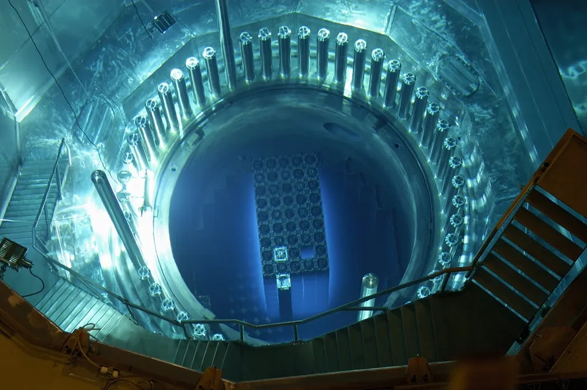

# 경북대학교 에너지공학부 원자력공학 전공

## 1. 전공 개요 (Overview)

원자력공학 전공은 원자핵 분열 및 융합 과정에서 발생하는 에너지의 평화적 이용을 연구하고, 관련 첨단 기술을 개발하는 학문이다. 지속 가능한 미래 에너지 시스템 구축을 목표로 원자력 발전, 방사선 응용 기술, 원자력 안전 및 환경 보전 등에 관한 종합적인 이론과 실무 능력을 갖춘 전문 엔지니어를 양성한다.

* **원자력 발전소 설계·운영**: 원자로물리, 원자로공학, 핵주기공학, 원자력시스템공학 등 핵심 공학 이론 학습
* **방사선 안전 및 응용**: 방사선의 안전한 관리와 산업·의료적 이용을 위한 방사선공학개론, 방사선관리학 연구

최근 기후변화 대응과 탄소중립 실현을 위한 핵심 에너지원으로서 원자력의 중요성이 재조명됨에 따라, 차세대 원자로 개발, 소형모듈원자로(SMR), 원전 해체 기술 등 다양한 미래형 원자력 기술 수요에 발맞춘 교육과정을 제공하고 있다.

## 2. 주요 연구 및 학문 분야

### (1) 원자로 노심 설계 및 열수력
원자로 내부의 핵분열 반응을 제어하고 열에너지를 효율적으로 전달하는 시스템을 설계한다. 냉각재의 흐름과 열전달 현상을 분석하여 원자로의 출력과 효율을 극대화함과 동시에 시스템의 열적 안정성을 확보한다.

### (2) 원자력 안전 및 계통 공학
원전 운영 중 발생할 수 있는 사고 가능성을 가상하고, 중대사고를 예방 및 완화하기 위한 다중 방어 시스템을 연구한다. 확률론적 안전성 평가(PSA) 기법과 정밀 해석 코드를 활용하여 원전의 절대적 안전성을 확보하는 데 주력한다.

### (3) 방사선 공학 및 응용 기술
방사선의 성질과 물질과의 상호작용을 이해하고, 이를 의료 진단/치료, 산업용 비파괴 검사, 신소재 개발, 환경 측정 등 다양한 분야에 적용하는 기술을 다룬다.

### (4) 차세대 에너지 및 SMR (소형모듈원자로)
기존 대형 원전에 비해 안전성과 경제성이 획기적으로 개선된 소형모듈원자로(SMR) 및 4세대 원자로(SFR, VHTR 등) 연구를 추진하며, 미래 상용화를 위한 핵심 기술을 다룬다.

### (5) 전력변환 및 에너지 소재
원자력 발전에서 생산된 열에너지를 전기 에너지로 가공·제어하는 AC/DC 변환, 전력 전자, 회로 이론을 다루며, 고온·고방사선 환경에 견디는 에너지 반도체 및 플라즈마 소재 특성을 분석한다.

---

## 3. 교육과정 및 진로
- **주요 과목**: 원자력공학개론, 핵물리학, 원자로이론, 방사선개론, 원자력열수력학, 원자력안전공학
- **졸업 후 진로**: 한국수력원자력(KHNP), 한국원자력연구원(KAERI), 한국원자력안전기술원(KINS), 두산에너빌리티, 현대건설 등

# 📚 주요 커리큘럼 (Curriculum)

경북대학교 에너지공학부의 이수 지침에 따라 전공 교과목 51학점 이상, 3·4학년 전공이론목록 중 해당 전공 분야 18학점 이상을 이수한다. 마이크로전공 모듈로 **'원자력에너지(Nuclear Energy)'** 과정을 제공하여 원자력 및 방사선 분야의 전문성을 강화한다.

---

## 🎓 학과 이수 지침 요약
- **전공 이수학점**: 전공 교과목 51학점 이상 이수 (단일 전공 시 12학점 추가 이수)
- **전공이론/MSC**: 3·4학년 전공이론 18학점 이상 및 MSC(수학·물리·화학·공학수학 등) 30학점 이상 이수

---

## ⚛️ 마이크로전공 모듈: 원자력에너지 (Nuclear Energy)

경북대학교 에너지공학부에서는 주전공/복수전공 외에도 특정 기술 분야의 전문성을 인증받을 수 있는 **'원자력에너지(Nuclear Energy)' 마이크로모듈(모듈코드: MI051202)** 특화 과정을 운영하고 있습니다.

### 1. 모듈 개요 및 이수 목적
* **개념**: 원자력 발전, 방사선 응용, 원자로 안전 및 계통 공학 관련 핵심 과목들을 체계적으로 이수하여 원자력 산업 분야에 특화된 실무 역량을 갖추도록 돕는 소규모 전문 인증 과정입니다.
* **목적**: 기후변화 대응 및 탄소중립 실현을 위한 기저발전원으로서 원자력의 중요성이 증가함에 따라, 차세대 SMR, 원전 해체, 방사선 안전 관리 등 미래형 원자력 산업에서 요구하는 맞춤형 공학 인재를 양성합니다.

### 2. 주요 구성 교과목 (총 6개 지정 과목)
마이크로모듈 이수를 위해서는 아래 지정된 핵심 전공 교과목 중 요건 학점 이상을 수강해야 합니다.
1. **`방사선공학개론` (EESO0220)**: 방사선 물리학 기초, 차폐 원리 및 의료/산업 응용
2. **`원자로공학` (EESO0223)**: 중성자 확산, 핵분열 연쇄반응, 노심 열수력 해석 및 출력 제어
3. **`원자력법령` (EESO0248)**: 원자력 안전법, 선량 기준 및 방사선 방호 규제 이해
4. **`방사선관리학` (EESO0249)**: 방사선 피폭 평가, 선량 계측 및 환경 방사선 관리 실무
5. **`원자로시스템공학` (EESO0251)**: 원전 1·2차 계통 설계, 사고 해석 및 다중 방어 시스템
6. **`기초핵공학실습` (EESO0260)**: 방사선 계측기 운용 및 핵반응 현상 직접 실습

### 3. 이수 혜택 및 진로 활용
* **이수증 발급**: 요건 충족 시 학위기 및 성적증명서에 마이크로전공 이수 사실이 공식 기재됩니다.
* **취업 경쟁력 강화**: 한국수력원자력(KHNP), 한국원자력연구원(KAERI), 한국원자력안전기술원(KINS) 등 원자력 관련 공공기관 및 두산에너빌리티, 건설사(원전 시공) 입사 지원 시 전공 전문성을 객관적으로 증명할 수 있습니다.
  
---

## 3학년: 원자력 공학 기초 및 방사선 제어

### 1학기: 방사선 기초 및 에너지 공학 기반
- **핵심 학습 내용**: 프로그래밍 및 수치적 해석 기초를 다지고, 방사선의 물리적 특성과 차폐 원리를 배웁니다. 더불어 원자력 관련 법령·제도를 이해하고 고온·고방사선 환경에 견디는 에너지 재료 및 전기화학 기초를 습득합니다.
- **주요 과목 영역**: `방사선공학개론`, `원자력법령`, `에너지재료공학`, `프로그래밍언어`

### 2학기: 방사선 안전 관리 및 핵공학 실습
- **핵심 학습 내용**: 방사선 피폭 평가 및 선량 계측 등 실무 중심의 방사선 관리 기술을 배웁니다. 직접 방사선 계측기 및 핵반응 실습을 수행하며, 수치해석적 문제 해결 능력과 차세대 에너지(태양광·촉매) 기반 기술을 함께 학습합니다.
- **주요 과목 영역**: `방사선관리학`, `기초핵공학실습`, `수치해석`, `태양전지/에너지촉매`

---

## 4학년: 원자로 심화 및 시스템 종합 설계

### 1학기: 원자로 이론 및 핵주기 시스템
- **핵심 학습 내용**: 원자로 내부의 중성자 연쇄반응, 노심 열수력 해석 및 출력 제어 원리를 집중 다룹니다. 우라늄 채굴부터 사용후핵연료 관리 및 방사성 폐기물 처분까지의 핵주기 전 과정과 차세대 에너지 변환·소자 공정을 이해하며 캡스톤 디자인 종합 설계를 시작합니다.
- **주요 과목 영역**: `원자로공학`, `핵주기공학`, `창의시스템설계1`, `에너지변환/소자공정`

### 2학기: 원자로 시스템 설계 및 융합 응용
- **핵심 학습 내용**: 원자력 발전소의 1·2차 계통, 가압기, 증기발생기 등 전체 원자로 시스템 해석과 사고 예방 기술을 완성합니다. 캡스톤 디자인 프로젝트 결과를 종합하고, 탄소중립 환경 공학 및 에너지 저장·박막 신소재 기술을 결합하여 엔지니어로서의 실무 역량을 다집니다.
- **주요 과목 영역**: `원자로시스템공학`, `창의시스템설계2`, `에너지환경`, `에너지변환소재/저장실습`
